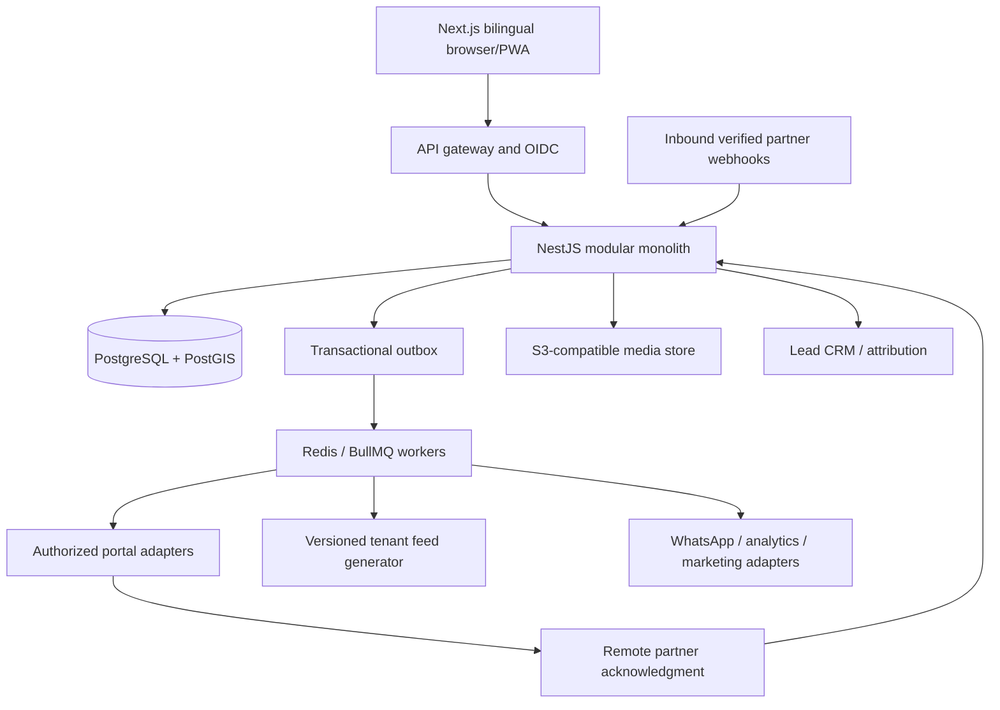

# Technical blueprint — canonical real estate operating system

This is a **production design**, NOT implemented code. It derives from the user-supplied Gemini PRD with pragmatic corrections to prevent unauthorized integrations.



## Domain modules and ownership

| Module | Authoritative responsibility | Core commands/queries |
|---|---|---|
| Identity / Organization | OIDC membership, RBAC, verification, org IDs and data isolation | createOrganization, inviteMember, verifyAdvertiser |
| Inventory | Canonical property facts, versions, media, Arabic/English, moderation | createDraft, reviseProperty, validate, approve, archive |
| Connector Registry | Provider capabilities, contract status, auth method, secrets refs | listCapabilities, prepareAuthorization, disableConnector |
| Syndication | Destination-aware status machine, payload transformer, retries and reconciliation | preflightDestination, publish, update, withdraw, listJobs |
| Feed Service | Signed tenant-specific XML/JSON/CSV, versioned schemas and access tokens | generateFeed, rotateFeedKey, reportFetch |
| CRM / Lead Router | Signed webhook intake, normalized lead, dedupe, assignment, SLA | ingestLead, deduplicate, assign, escalate |
| Marketing | Meta / Google proposals, policy checks, approvals and spend caps | draftCampaign, approve, submit, reconcileCost |
| Messaging | Official WhatsApp templates, consent, inbox, human handover | receiveMessage, sendTemplate, optOut, assignConversation |
| Billing | Plans, subscription, quotas/credit ledger, payment callbacks | quote, subscribe, consumeEntitlement, settleWebhook |
| Analytics | First-party events, consent, server dedupe, attribution and verified ROI | recordEvent, normalizeSource, aggregateChannel |
| AI Gateway | Model policy, tenant scopes, factual tool access, budgets, evaluations | draftCopy, suggestMedia, scoreLead, logTrace |
| Admin/Audit | Tenant support, credentials oversight, moderation, immutable append-only audit | reviewAudit, monitorConnector, policyUpdate |

## Core record boundaries

- `organization(id, country, license, status)`; `user(id, ...)`; `membership(id, org_id, role, ...)` separate from user for multi-org membership.
- `property(id, org_id, purpose, type, price_minor, currency, rental_frequency, permit, owner_verified, version, source, ...)`; `property_translation(property_id, locale, title, description)`; `property_media(property_id, room_category, object_key, order, status, ...)`; `property_revision(property_id, version, ...)`. Coordinates stored as PostGIS `geography` with explicit precision and consent policy.
- `connector_definition(id, region, capability_schema_version, auth_type)`; `org_connector(id, org_id, provider_id, credential_ref, agreement_status, mode, lifecycle)`; never store raw keys in client or unencrypted JSON.
- `publication(id, org_id, property_id, property_revision, provider_id, external_reference, status)` and `publication_attempt(id, event_id, payload_digest, idempotency_key, retries, error_code, ack_at)`; one destination failing must not incorrectly set the master listing to "unpublished".
- `feed(id, org_id, provider_id, version, access_ref, format, next_schedule, last_fetch_at)`; securely authorized feeds only.
- `lead(id, org_id, listing_id, source_provider, source_lead_id, normalized_contact_hash, original_event_id, consent_id, assignee_id, stage, ...)`; uniqueness keyed per-tenant/source + event for dedupe, not by person's name alone.
- `plan`, `plan_entitlement`, `org_subscription`, `credit_ledger`, `invoice`, `payment_event`; enforce quotas transactionally at command time. Example prices from Gemini require sponsor approval.
- `consent` with purpose, channel and timestamp; immutable audit and retention schedules; data rights requests and access logs.

## Publishing state machine

`draft -> validated -> approved -> queued -> dispatched -> accepted` or `rejected`, `retry_wait`, `cancelled`, `withdraw_requested`, `withdrawn`. `accepted` only after authorized partner acknowledgement; a successful local queue insertion or HTTP 200 from feed generation does not prove a live portal listing. Every attempt and external ID is tracked separately. Use transactional outbox, idempotency keys, exponential backoff, poison-message DLQ and reconciliation jobs.

## API design (illustrative REST/OpenAPI resource shape)

```
POST   /v1/orgs/:orgId/properties
PATCH  /v1/orgs/:orgId/properties/:id              If-Match revision
GET    /v1/orgs/:orgId/properties/:id
POST   /v1/orgs/:orgId/properties/:id/media:prepare
POST   /v1/orgs/:orgId/properties/:id/validate
GET    /v1/orgs/:orgId/connectors
POST   /v1/orgs/:orgId/connectors/:id/authorize
GET    /v1/orgs/:orgId/connectors/:id/capabilities
POST   /v1/orgs/:orgId/properties/:id/publish      Idempotency-Key
GET    /v1/orgs/:orgId/properties/:id/publications
GET    /v1/orgs/:orgId/publication-jobs
GET    /v1/orgs/:orgId/feeds/:id
POST   /v1/orgs/:orgId/feeds/:id/rotate
POST   /v1/webhooks/:provider                     signed + replay protected
GET    /v1/orgs/:orgId/leads
POST   /v1/orgs/:orgId/leads/assignments:preview
POST   /v1/orgs/:orgId/viewing-requests
GET    /v1/orgs/:orgId/analytics/channels
GET    /v1/orgs/:orgId/subscription/entitlements
```

Every org ID is validated against authenticated membership server-side, not trusted because the path contains it. API resource schemas and errors are defined through OpenAPI; no provider-specific request DTO escapes its adapter boundary.

## Integration decision records needed

1. Portal contract/capability matrix per provider + geography; do not scrape or use unofficial headless bridges.
2. Meta housing-ad rules, catalogue capabilities, consent/Pixel/CAPI policies, client/server event dedupe and approval gates.
3. Google Ads eligibility and real estate feed mode; no universal PMax real-estate feed assumption.
4. GA4 browser tagging + server Measurement Protocol as complement, no public API secrets.
5. WhatsApp official Cloud API/BSP, template approval, 24-hour messaging constraints, opt-in/out and human handover.
6. Qatar-supported payment gateway, 3DS, reconciliation, tax/invoice legal review and exactly-once payment effects.
7. AI provider/data residency, evaluation thresholds, grounded listing tools, quality and credit controls.

## NFR acceptance design

- Scale target from earlier brief: 50k live listings and 1k concurrent users; verify load behavior rather than promising it from a prototype.
- Public LCP target ≤2.5s on 4G; search p95 ≤500ms subject to measured environment. WCAG AA and Arabic-native UX.
- Required isolation, consent, logs, encryption, WAF, secrets manager, regular backups, tested restore and independent security review.
- Admin/advertiser spend approvals enforced outside the model; every high-impact operation audited.
