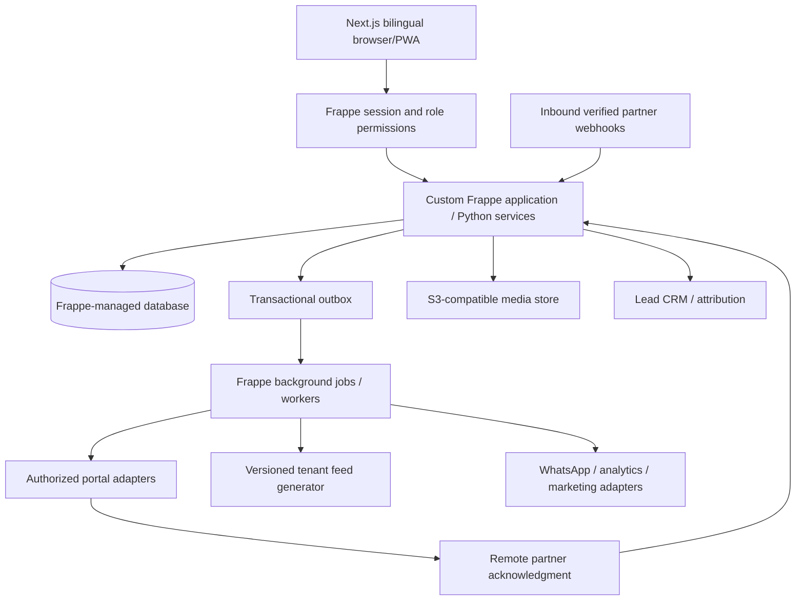

# Technical blueprint — canonical real estate operating system

**2026-11-13 Phase 5:** custom Frappe application supersedes the earlier NestJS proposal; see `22-frappe-backend-blueprint.md`. This is a **production design**, NOT implemented code. It derives from the user-supplied Gemini PRD with pragmatic corrections to prevent unauthorized integrations.



## Domain modules and ownership

| Module | Authoritative responsibility | Core commands/queries |
|---|---|---|
| Identity / Organization | Frappe identity and membership, RBAC, verification, org IDs and data isolation | createOrganization, inviteMember, verifyAdvertiser |
| Inventory | Canonical property facts, versions, media, Arabic/English, moderation | createDraft, reviseProperty, validate, approve, archive |
| Connector Registry | Provider capabilities, contract status, auth method, secrets refs | listCapabilities, prepareAuthorization, disableConnector |
| Syndication | Destination-aware status machine, payload transformer, retries and reconciliation | preflightDestination, publish, update, withdraw, listJobs |
| Feed Service | Signed tenant-specific XML/JSON/CSV, versioned schemas and access tokens | generateFeed, rotateFeedKey, reportFetch |
| CRM / Lead Router | Signed webhook intake, normalized lead, dedupe, assignment, SLA | ingestLead, deduplicate, assign, escalate |
| Marketing | Meta / Google proposals, policy checks, approvals and spend caps | draftCampaign, approve, submit, reconcileCost |
| Messaging | Official WhatsApp templates, consent, inbox, human handover | receiveMessage, sendTemplate, optOut, assignConversation |
| Billing | Plans, subscription, quotas/credit ledger, payment callbacks | quote, subscribe, consumeEntitlement, settleWebhook |
| Analytics | First-party events, consent, server dedupe, attribution and verified ROI | recordEvent, normalizeSource, aggregateChannel |
| AI Gateway | Model policy, tenant scopes, factual tool access, budgets, evaluations | draftCopy, suggestMedia, scoreLead, logTrace |
| Admin/Audit | Tenant support, credentials oversight, moderation, immutable append-only audit | reviewAudit, monitorConnector, policyUpdate |

## Core record boundaries

- `organization(id, country, license, status)`; `user(id, ...)`; `membership(id, org_id, role, ...)` separate from user for multi-org membership.
- `property(id, org_id, purpose, type, price_minor, currency, rental_frequency, permit, owner_verified, version, source, ...)`; `property_translation(property_id, locale, title, description)`; `property_media(property_id, room_category, object_key, order, status, ...)`; `property_revision(property_id, version, ...)`. Coordinates stored using the approved Frappe/database geospatial representation with explicit precision and consent policy; no PostGIS assumption.
- `connector_definition(id, region, capability_schema_version, auth_type)`; `org_connector(id, org_id, provider_id, credential_ref, agreement_status, mode, lifecycle)`; never store raw keys in client or unencrypted JSON.
- `publication(id, org_id, property_id, property_revision, provider_id, external_reference, status)` and `publication_attempt(id, event_id, payload_digest, idempotency_key, retries, error_code, ack_at)`; one destination failing must not incorrectly set the master listing to "unpublished".
- `feed(id, org_id, provider_id, version, access_ref, format, next_schedule, last_fetch_at)`; securely authorized feeds only.
- `lead(id, org_id, listing_id, source_provider, source_lead_id, normalized_contact_hash, original_event_id, consent_id, assignee_id, stage, ...)`; uniqueness keyed per-tenant/source + event for dedupe, not by person's name alone.
- `plan`, `plan_entitlement`, `org_subscription`, `credit_ledger`, `invoice`, `payment_event`; enforce quotas transactionally at command time. Example prices from Gemini require sponsor approval.
- `consent` with purpose, channel and timestamp; immutable audit and retention schedules; data rights requests and access logs.

## Publishing state machine

`draft -> validated -> approved -> queued -> dispatched -> accepted` or `rejected`, `retry_wait`, `cancelled`, `withdraw_requested`, `withdrawn`. `accepted` only after authorized partner acknowledgement; a successful local queue insertion or HTTP 200 from feed generation does not prove a live portal listing. Every attempt and external ID is tracked separately. Use transactional outbox, idempotency keys, exponential backoff, poison-message DLQ and reconciliation jobs.

## API design (illustrative REST/OpenAPI resource shape)

```
POST   /v1/orgs/:orgId/properties
PATCH  /v1/orgs/:orgId/properties/:id              If-Match revision
GET    /v1/orgs/:orgId/properties/:id
POST   /v1/orgs/:orgId/properties/:id/media:prepare
POST   /v1/orgs/:orgId/properties/:id/validate
GET    /v1/orgs/:orgId/connectors
POST   /v1/orgs/:orgId/connectors/:id/authorize
GET    /v1/orgs/:orgId/connectors/:id/capabilities
POST   /v1/orgs/:orgId/properties/:id/publish      Idempotency-Key
GET    /v1/orgs/:orgId/properties/:id/publications
GET    /v1/orgs/:orgId/publication-jobs
GET    /v1/orgs/:orgId/feeds/:id
POST   /v1/orgs/:orgId/feeds/:id/rotate
POST   /v1/webhooks/:provider                     signed + replay protected
GET    /v1/orgs/:orgId/leads
POST   /v1/orgs/:orgId/leads/assignments:preview
POST   /v1/orgs/:orgId/viewing-requests
GET    /v1/orgs/:orgId/analytics/channels
GET    /v1/orgs/:orgId/subscription/entitlements
```

Every org ID is validated against authenticated membership server-side, not trusted because the path contains it. API resource schemas and errors are defined through OpenAPI; no provider-specific request DTO escapes its adapter boundary.

## Integration decision records needed

1. Portal contract/capability matrix per provider + geography; do not scrape or use unofficial headless bridges.
2. Meta housing-ad rules, catalogue capabilities, consent/Pixel/CAPI policies, client/server event dedupe and approval gates.
3. Google Ads eligibility and real estate feed mode; no universal PMax real-estate feed assumption.
4. GA4 browser tagging + server Measurement Protocol as complement, no public API secrets.
5. WhatsApp official Cloud API/BSP, template approval, 24-hour messaging constraints, opt-in/out and human handover.
6. Qatar-supported payment gateway, 3DS, reconciliation, tax/invoice legal review and exactly-once payment effects.
7. AI provider/data residency, evaluation thresholds, grounded listing tools, quality and credit controls.

## NFR acceptance design

- Scale target from earlier brief: 50k live listings and 1k concurrent users; verify load behavior rather than promising it from a prototype.
- Public LCP target ≤2.5s on 4G; search p95 ≤500ms subject to measured environment. WCAG AA and Arabic-native UX.
- Required isolation, consent, logs, encryption, WAF, secrets manager, regular backups, tested restore and independent security review.
- Admin/advertiser spend approvals enforced outside the model; every high-impact operation audited.


## Phase 4 additive browser-local marketing contract (OpenSpec 0008)

This section describes implemented prototype boundaries, not production architecture. The existing `schemaVersion:1` repository gains `campaignSchemaVersion:1` / `campaigns`; connector version 2 and CRM version 1 remain compatible. Pre-campaign repositories migrate to an empty portfolio. Restore projects known fields, validates organization/property/media references and revision-bound approval ordering, recovers malformed records visibly and reconciles stale property references. Campaign cost IDs must match the shared CRM cost ledger; invalid costs are excluded with a warning.

`Campaign` version 1 references canonical property ID/revision and media IDs. It owns proposed bilingual copy/headlines, objective, platform, conversion goal, broad/unsupported targeting examples, dates, media budget, separately disclosed fee, local checklist, approval receipts, local status, proposal review history and explicit fictional costs. It stores no canonical fact snapshot, creative bytes, customer identity or credentials. A campaign's property association is immutable; a platform with simulation observations requires duplication before changing source. Property edits invalidate campaign approvals atomically through the shared store. Campaign edits/accepted proposals bind a new revision; historical events remain local audit evidence.

`applyCampaignCommand` is the single marketing command boundary, separate from `MarketingAIService`. It checks organization, a known local role, expected revision, current canonical reference, plan/example budget cap, ordered policy/advertiser/admin review, current receipts and local provider setup before simulation. Selectable roles are explicitly a demonstration, not authenticated RBAC. Internal example total caps (Starter 500 / Pro 5,000 / Agency 25,000 QAR including fees) are unapproved planning guards, not Gemini-approved commercial entitlements. Starter's Meta exclusion is preserved. Provider/legal rules remain independently unverified.

The current `localMarketingAI` implements the provider-agnostic proposal contract without network calls. All factual content derives from reviewed canonical fields; suggestions carry source paths/revisions and never grant approval. Arbitrary edited copy requires human policy review; a numeric-claim check is illustrative, not semantic/legal verification. Weekly drafts use the existing dated local CRM observations and Qatar date boundaries. Production needs authenticated tenant-scoped tools, grounding evaluations, consent, budgets, provider policy and durable traces.

Campaign enquiry commands use existing CRM intake and its organization/source/event deduplication key. Meta uses the existing Meta Lead Ads internal contract; Google uses Website first-touch plus a Google campaign reference, pending an authorized Google intake contract. Unknown historical campaign examples remain raw references without inventing a canonical campaign. No replay changes first-touch identity or routing. Reports use shared `selectLeads`/`leadMetrics` and explicit dated fictional campaign costs; a budget or queue click never creates actual spend or provider performance. Recording a campaign cost also adds exactly one source-level CRM cost row. No reach/click/ROAS calculation is implemented.

Production marketing must move these commands behind authenticated Frappe permissions, tenant-scoped transactions and append-only audit/outbox/idempotency; obtain current approved housing/policy/account/region/feed contracts; store credentials in Vault/KMS; obtain application-enforced approvals and consent; and reconcile real costs/status only from authorized partner acknowledgements. Nothing here authorizes commercial publishing or spend.

## Phase 5 organization boundary (GEM-01 / 17 / 18 / 19 / 20)

`organization-engine.ts` and `organization-storage.ts` add shared typed browser-local profiles, membership, selected fictional personas, central permissions, effective illustrative plan configuration, canonical revision-bound moderation and audit. Local command guards apply across property/publishing/CRM/campaign/billing/admin. `prototype-repository.ts` defines the data boundary with a local adapter; no Frappe API is called. Directory profiles do not select another operational dataset. See `21-phase5-organization-admin.md` for evidence and prototype limitations. Production must enforce every invariant in Frappe authenticated document permissions/controllers/whitelisted methods, with transactional quotas, outbox, revisions, isolation and durable audit as specified in the blueprint.


## Phase 6 selected-organization frontend boundary

Phase 6 supersedes the Phase 5 directory-only restriction. The browser envelope now carries independent operational slices and selected organization context; command guards validate linked organization ownership, and publishing approval context includes the organization ID. This remains editable UX simulation, not server isolation. `api-contracts.ts` proposes scoped paginated reads, errors/loading states and approval/acknowledgment DTOs for a separately implemented Frappe adapter. See `25-frappe-integration-readiness.md`. No backend framework, database version, real credentials or API transport is added.
